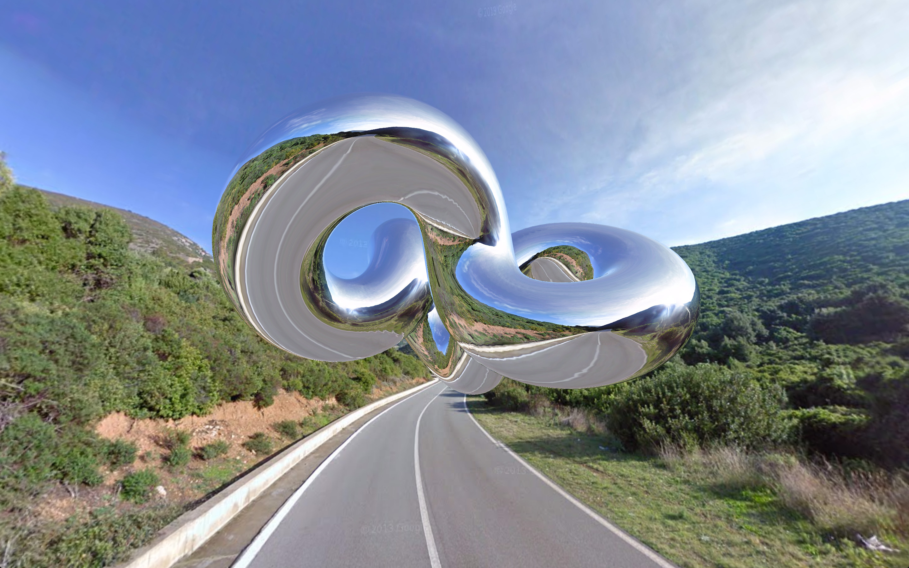

# floating-shiny-knot
Floating Shiny Knot

Source code for Floating Shiny Knot, an experiment I did in 2012 to use Google Street View panoramas as environment mapping, while learning 3D graphics and three.js

#### Demo ####
- **[Floating Shiny Knot](https://spite.github.io/floating-shiny-knot/)**: click on the map or search for an address to get the panorama there. Drag to look around, mouse wheel to zoom

#### 2026 update ####
**Disclaimer:** this is the 2012 version, kept as it was, with the minimal changes to make it work again. It runs on three.js r58, which is included. There's a [2022 remake](https://github.com/spite/FloatingShinyKnot) with better shading. The panoramas come from undocumented Google endpoints that can change or disappear without notice, see [PanomNom.js](https://github.com/spite/PanomNom.js)

What changed:

- the panoramas are loaded with [PanomNom.js](https://github.com/spite/PanomNom.js), instead of [GSVPano.js](https://github.com/spite/GSVPano.js/), which no longer works. `PanomNom.module.js` is a copy of its build
- it only asks for Google's own Street View panoramas. Without an API key, the ones that people upload are returned first, and their images can't be loaded the same way
- the map is [Leaflet](https://leafletjs.com/) with OpenStreetMap, and the address search uses OpenStreetMap's [Nominatim](https://nominatim.org/), as a Google map and Google's geocoder need an API key. The Google Maps API is still loaded, only to find the panorama nearest to a location, which works without one. Pressing Enter in the search box searches instead of reloading the page
- a panorama that arrives after a newer one was asked for is ignored
- the knot and the camera move at the same speed at any refresh rate. They moved a step per frame, so twice as fast on a 120Hz screen
- the Google Maps API is loaded over https and without the `sensor` parameter, the Google+ button is gone, and the placeholder image that was missing is back
- it's on GitHub Pages

#### License ####

MIT licensed

Copyright (C) 2012 Jaume Sanchez Elias, http://www.clicktorelease.com
